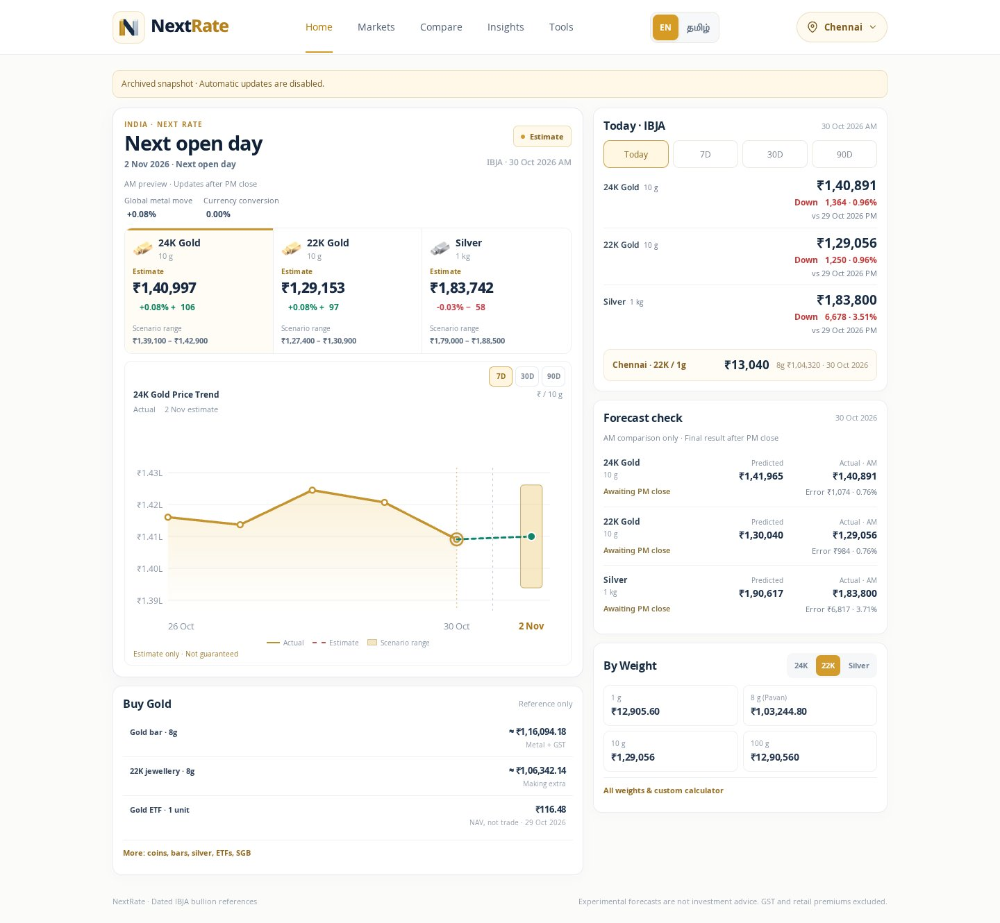
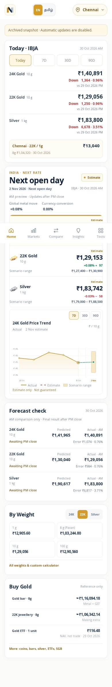

<div align="center">


# NextRate

**Archived source for the English/Tamil gold and silver dashboard.**


[📸 All 40 screenshots](docs/screenshots/README.md) · [Run locally](#run-locally) · [Retirement record](docs/RETIREMENT.md)

</div>

---

> **Retired on 30 October 2026.** Automatic market refresh and deployment are disabled. The repository retains the application, collector/model source, tests, final dated data, and screenshots. This is an archive, not a live price service.

## 📸 Application gallery

Every tab and all three tools are captured on desktop and mobile, in **English and Tamil**. The [complete gallery](docs/screenshots/README.md) also includes 7D/30D/90D changes, chart periods, and expanded home calculators. Click an image for its full-page view.

| Desktop | Mobile |
|---|---|
| [](docs/screenshots/desktop-en-home.jpg) | [](docs/screenshots/mobile-en-home.jpg) |

| View | Desktop | Mobile |
|---|---|---|
| Markets | [Screenshot](docs/screenshots/desktop-en-markets.jpg) | [Screenshot](docs/screenshots/mobile-en-markets.jpg) |
| Compare | [Screenshot](docs/screenshots/desktop-en-compare.jpg) | [Screenshot](docs/screenshots/mobile-en-compare.jpg) |
| Insights | [Screenshot](docs/screenshots/desktop-en-insights.jpg) | [Screenshot](docs/screenshots/mobile-en-insights.jpg) |
| Sell / Exchange | [Screenshot](docs/screenshots/desktop-en-tools-resale.jpg) | [Screenshot](docs/screenshots/mobile-en-tools-resale.jpg) |
| Verify Hallmark | [Screenshot](docs/screenshots/desktop-en-tools-hallmark.jpg) | [Screenshot](docs/screenshots/mobile-en-tools-hallmark.jpg) |
| ETF Comparison | [Screenshot](docs/screenshots/desktop-en-tools-etfs.jpg) | [Screenshot](docs/screenshots/mobile-en-tools-etfs.jpg) |
| தமிழ் | [All Tamil screens](docs/screenshots/README.md#tamil) | [Tamil mobile home](docs/screenshots/mobile-ta-home.jpg) |

Screenshots use the real saved publication from **30 October 2026, 13:45 IST**. The capture clock stays at the snapshot time so the historical forecast can be inspected with its original labels. Prices are not relabelled as current. Offline publisher emblems use the app's text fallback badges.

## ✨ Preserved features

- **Home:** dated IBJA rates, daily and 7D/30D/90D changes, charts, experimental estimates and forecast checks.
- **Markets:** indicative global metal and currency references, with observation dates and units.
- **Compare:** dated city quotes, separate from the national benchmark.
- **Insights:** metal purity, buying guides and common questions.
- **Tools:** Sell / Exchange, Verify Hallmark and ETF Comparison.
- **Languages:** English and Tamil, with responsive desktop and mobile layouts.

Forecasts are experimental; archived estimates are not current predictions or guarantees of accuracy. IBJA benchmarks exclude GST and making charges. Fund NAVs are not executable ETF prices. The hallmark tool points to BIS Care; the app cannot itself verify an HUID.

## Run locally

The frontend needs no build step and reads only committed JSON by default:

```bash
git clone https://github.com/Vignesh-S-GitHub/Next-Rate.git
cd Next-Rate
python -m http.server 8080
```

Open **http://localhost:8080**. The archive banner identifies the saved data. No Worker, database, credentials, timer, or remote market API is needed. Old forecasts are withheld when their target date has passed.

## 🗃️ Data preservation

The final six application documents are in [data/](data/). [Annual archives](data/archive/) retain the published history. The compressed [D1 export](data/retired-cloudflare/2026-10-30.sql.gz) preserves the final publication, **363 observations and 52 refresh records**. Its [manifest](data/retired-cloudflare/manifest.json) records the revision, row counts and uncompressed SQL checksum.

Cloudflare source is retained under [cloudflare/nextrate-scheduler/](cloudflare/nextrate-scheduler/) for reference. Its cron list and database bindings are empty. The previous Pages deployment workflow is retained as an inactive [.example file](docs/reference/pages.yml.example); there are no active workflows in `.github/workflows/`.

The old operations documents describe the former hosted service. [RETIREMENT.md](docs/RETIREMENT.md) supersedes those instructions. Running a build does not recreate or deploy infrastructure.

## 🧪 Checks and screenshots

```bash
python -m unittest discover -s tests -v
node --test tests/*.test.cjs
python scripts/archive_data.py --verify
python scripts/validate_publication.py
npm ci
npx playwright install chromium
npm run test:browser
node scripts/capture_screenshots.cjs
```

`test:browser` checks all 40 archived screen states without changing screenshots. The final command recreates the gallery. Collector regression tests also need `npm ci --prefix cloudflare/nextrate-scheduler`. Historical live-service browser scenarios remain in `tests/browser-smoke.cjs` as reference; the active browser command checks the archived application.

## 📁 Source guide

| Path | Purpose |
|---|---|
| `index.html`, `app.js`, `styles.css` | Dashboard and layout |
| `features.js`, `features-core.js` | The three tools |
| `chart-ui.js`, `chart-interaction.js` | Historical charts and interactions |
| `data-loader.js`, `data-quality.js` | Archived document loading and validation |
| `cloudflare/nextrate-scheduler/` | Preserved collector and forecast implementation |
| `scripts/`, `tests/` | Offline tools and checks |
| `docs/screenshots/` | Full desktop/mobile screenshot gallery |

## 📊 Original data sources

[IBJA](https://www.ibjarates.com/) · [Goodreturns](https://www.goodreturns.in/gold-rates/) · [AMFI](https://www.amfiindia.com/) · [Gold API](https://gold-api.com/docs) · [Frankfurter](https://frankfurter.dev/)

Provider data and branding have their own terms. No repository-level `LICENSE` is included.
